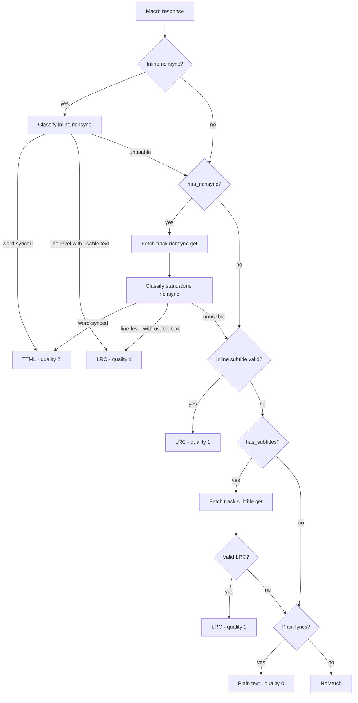

# Musixmatch

`musixmatch` is a pure-JVM client for Musixmatch's mobile API
(`apic-appmobile.musixmatch.com`). It does not depend on Android or on any
other lyrics module. The Android app wraps the singleton in its own
`LyricsProvider` and is responsible for provider ordering, caching, and
displaying attribution.

| File | Responsibility |
|---|---|
| `Musixmatch.kt` | Public API, token lifecycle, macro requests, playback/search orchestration |
| `MusixmatchInternal.kt` | API envelope decoding, standalone richsync/subtitle requests, internal request types |
| `MusixmatchSearch.kt` | Candidate filtering, ranking, fallback search |
| `LyricsFormat.kt` | Richsync classification, LRC parsing/comparison/synthesis |
| `MusixmatchTtml.kt` | Richsync → TTML conversion |
| `SearchTokenState.kt` | Per-operation token renewal and terminal-failure tracking |
| `models/` | `kotlinx.serialization` response models |

## Public API

The public entry point is the `Musixmatch` object.

### `getLyrics(title, artist, album = null, durationSeconds = -1)`

Fetches one best-effort result for playback.

| Parameter | Type | Description |
|---|---|---|
| `title` | `String` | Track title. Blank values return `Result.failure(IllegalArgumentException)` |
| `artist` | `String` | Artist name. Blank values return `Result.failure(IllegalArgumentException)` |
| `album` | `String?` | Optional album, passed as `q_album` to the matcher |
| `durationSeconds` | `Int` | Track length in seconds; `-1` disables duration filtering |

Returns `Result<String>`. The returned string is one of:

- TTML XML with word-level timing;
- LRC with line timestamps;
- plain text.

Failures are represented by `MusixmatchError` subclasses inside
`Result.failure`. `CancellationException` is always rethrown.

The playback path first asks the macro matcher by metadata. If the matcher
returns no usable track or rejects it with `NoMatch`/`Mismatch`, it runs a
ranked `track.search` fallback. A track marked instrumental is returned as
`"♪ Instrumental ♪"`.

### `getAllLyrics(title, artist, album = null, durationSeconds = -1, callback)`

Fetches multiple candidates through `track.search` and invokes `callback` for
each successful result.

- Page size is 20; at most 4 candidates are selected.
- Candidate fetches run with a concurrency limit of 2.
- Callbacks are serialized with a mutex, but their order is completion order,
  not ranking order.
- If search returns no candidates, the method falls back to one matcher call
  by title/artist.
- Instrumental candidates are skipped.
- `TokenInvalid` and `RateLimited` stop the queue and are thrown after the
  in-flight callbacks finish. Other per-candidate failures are ignored.
- Unlike `getLyrics`, this method is not wrapped in `Result`; callers must
  handle thrown errors.

### `logger`

`Musixmatch.logger` is an optional `(String) -> Unit` hook. It receives
operational messages such as request phase, candidate rank, quality, and
failure labels. It does not receive tokens, full URLs, response bodies, or
lyrics.

## Request lifecycle

### 1. Token

`getToken()` is single-flight:

- a cached token is returned immediately;
- concurrent callers share one `Mutex` and one `token.get` request;
- a successful token is stored in `cachedToken` for the process lifetime.

The token is never persisted to disk by this module.

### 2. Macro request

The main request is `macro.subtitles.get` with:

```text
format=json
namespace=lyrics_richsynched
subtitle_format=mxm
optional_calls=track.richsync
richsync_compact_type=words
```

By-name requests add `q_track`, `q_artist`, optional `q_album`, and
`q_duration`/`f_subtitle_length` when duration is positive. By-id requests use
`track_id` instead.

The macro response can contain:

- `matcher.track.get`
- `track.lyrics.get`
- `track.subtitles.get`
- `track.richsync.get`

### 3. Format resolution

Resolution is a decision tree, not a linear fallback chain. It is biased
toward true word-level timing, so a standalone richsync request is attempted
before inline subtitle fallback.



Inline richsync is often missing even when standalone richsync exists. Trying
inline LRC first would therefore prevent most tracks from ever reaching
standalone word-sync. The subtitle branch is only reached after both inline
and standalone richsync are unusable or unavailable.

### 4. Terminal enrichment errors

A standalone richsync or subtitle request can hit a terminal error
(`TokenInvalid` or `RateLimited`). The resolver still returns any usable
fallback it already has, but carries the terminal error on
`ResolvedLyrics.terminalError`. `getLyrics` surfaces that error instead of
silently returning the fallback. `getAllLyrics` records it, lets other
candidates finish, then throws the earliest ranked terminal error.

## Token renewal

Each operation owns a `SearchTokenState`. On an HTTP 401 or API status 401:

1. The operation tries to renew the token once.
2. If another caller has already replaced the token, the newer token is used
   without another network call.
3. The failed request is retried once with the renewed token.
4. A second 401, a failed renewal, or a rate-limit response becomes terminal.

`RateLimited` is terminal immediately; it does not trigger renewal.

## Richsync classification

`LyricsFormat.analyzeRichSync()` treats a line as content-bearing when it has
at least one non-blank word or non-blank `x` text.

A line is **timed** when:

- it has at least two non-blank words, and
- the spread between the minimum and maximum word offsets is greater than
  `0.05s`.

A payload is **word-synced** when:

```text
nonEmptyLines > 0
and
timedLines / nonEmptyLines >= 0.5
```

This threshold avoids turning a mostly line-level payload into fake
word-level animation just because one short line has multiple tokens.

### Output rules

| Input | Output |
|---|---|
| Word-synced richsync | TTML with `<span>` word timings |
| Line-level richsync + equivalent official LRC | Official LRC |
| Line-level richsync without equivalent LRC | Synthesized LRC from richsync `ts` |
| LRC subtitle list | LRC sorted by timestamp |
| Raw LRC | Trimmed raw LRC, or parsed lines for comparison |
| Plain lyrics body | Plain text with license footer lines removed |

The internal quality values carried by `ResolvedLyrics` are:

| Value | Meaning |
|---|---|
| `2` | Word-synced TTML |
| `1` | Line-synced LRC (official or synthesized) |
| `0` | Plain text |

### LRC equivalence

`compareWithLrc()` normalizes text with NFKC, collapses whitespace, removes
empty lines and `♪`-only lines, then requires:

- the same number of non-empty lines;
- identical normalized text per line;
- timestamp difference no greater than `0.05s` per line.

Only an `EQUIVALENT` match allows the official LRC to be returned. Otherwise
the module synthesizes LRC from richsync so line timings cannot silently
disagree with the word-timed payload.

### LRC parsing

`parseLrc()` accepts two shapes:

- a JSON subtitle array with `text` and `time.total`;
- raw LRC lines.

Raw LRC supports multiple timestamps on one line:

```text
[00:05.00][00:01.00] Repeated chorus
```

All timestamps are extracted, the text after the last timestamp is used, and
the resulting lines are sorted chronologically. JSON subtitle lines are also
sorted before comparison.

## Search fallback and ranking

`getLyrics` uses `track.search` only after `NoMatch` or `Mismatch`. The
fallback selects at most 2 candidates. `getAllLyrics` selects at most 4.

Candidate filtering:

- `track_id > 0`;
- not instrumental;
- duration within `8` seconds when both input and candidate durations are
  known.

Ranking:

1. version demerit (remix/live/cover/instrumental/acoustic/arrangement/
   tribute/karaoke markers);
2. track rating descending;
3. original response order for ties.

The playback fallback races the selected candidates and chooses the best
success with this comparator:

```text
demerit ascending
→ quality descending
→ track rating descending
→ rank ascending
```

If the current best cannot be beaten by any remaining candidate, the other
in-flight candidate jobs are cancelled early.

## Errors

All public failures derive from `MusixmatchError`:

| Error | Meaning |
|---|---|
| `TokenInvalid` | Missing, rejected, or unrenewable token |
| `RateLimited` | HTTP/API 401 or 429 that must stop the operation |
| `NoMatch` | No matcher track or no usable lyrics format |
| `Restricted` | Lyrics are marked restricted |
| `Instrumental` | Track is instrumental |
| `ServerError` | HTTP/API 5xx |
| `MalformedResponse` | Unparseable or unexpected envelope/body |
| `Mismatch` | Duration or title/artist validation failed |

For `getLyrics`, only `NoMatch` and `Mismatch` trigger the ranked search
fallback. Other failures are returned through `Result.failure`.

## HTTP configuration

- Base URL: `https://apic-appmobile.musixmatch.com/ws/1.1/`
- App ID: `mac-ios-v2.0`
- Request timeout: 20 seconds
- Connect timeout: 15 seconds
- Socket timeout: 20 seconds
- `expectSuccess = false`; status codes are checked manually
- Engine: OkHttp by default; tests inject `MockEngine`

The module does not cache lyrics. Token caching is in-memory only; the app owns
lyrics caching and provider selection.

## Integration notes

The Android wrapper should:

1. expose `Musixmatch.getLyrics()` as a `LyricsProvider`;
2. register it in `LyricsHelper` and the provider settings;
3. if cold-start token latency matters, expose a small public prewarm hook
   around `getToken()` and call it when the lyrics screen opens. `getToken()`
   is internal to this module today.

The app's provider race gives the first non-word-synced result a short grace
period before cancelling slower providers. A cold Musixmatch request has to
complete `token.get` and `macro.subtitles.get` sequentially, so on some
networks it can lose to an already-warm plain YouTube Music result. If
Musixmatch should win that race, add the prewarm hook above or give the app's
provider race a longer grace period for plain results.

## Testing

Run the module tests with:

```bash
gradle :musixmatch:test
```

The suite covers token single-flight and renewal, macro guards, instrumental
and restricted paths, richsync classification, LRC equivalence/synthesis,
standalone richsync and subtitle fallback, candidate ranking, concurrency,
logging redaction, and TTML round-tripping.

## Attribution

The Musixmatch mobile API header set and token acquisition approach are
adapted from Spicetify CLI's `lyrics-plus` provider:

https://github.com/spicetify/cli/blob/main/CustomApps/lyrics-plus/ProviderMusixmatch.js
